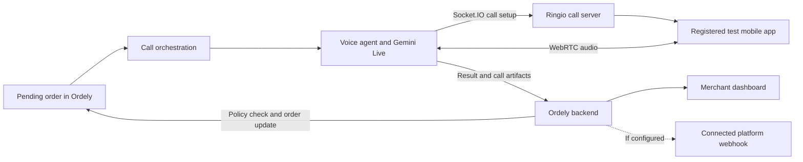

# How Order Confirmation Calls Work

## In brief

Ordely keeps orders and call attempts organized. When a pending order is eligible, its backend can hand a call task to the voice agent. For the current test setup, Ringio connects that agent to an available test mobile app. This is a simulated call: it does not dial the customer's real phone through a mobile carrier.

The agent talks with the person on the test app, then sends Ordely a structured call result. Ordely, not the AI agent, decides whether that result is clear and reliable enough to change the order.

## The journey

The test app stands in for the phone endpoint. Ringio coordinates the simulated connection; it does not place a SIM or PSTN call. The signaling and audio paths are different: Ringio carries call-control messages, while WebRTC carries the audio between the agent and app.

## What each part does

| Part | In everyday terms |
| --- | --- |
| Ordely dashboard | Where the merchant manages orders and reviews call attempts and results. |
| Ordely backend | Applies shop rules, starts eligible call attempts, receives agent results, and controls order changes. |
| PostgreSQL database | Stores orders, call attempts, and related business records. |
| Call orchestrator | Selects eligible pending orders, observes calling hours and retry rules, and dispatches work when the agent is available. |
| Ringio | Routes a simulated call to an available, registered test app and carries the setup messages. |
| Voice agent (Maria) | Speaks with the person on the test app, handles the conversation, and reports a structured result. |
| Gemini Live | Provides real-time speech understanding and generated voice for the agent. |
| WebRTC | Carries live audio between the agent and the test app after they connect. |

## How an order decision is made

The agent reports what it understood, along with a confidence score. Ordely checks the result against its policy and verifies that the order is still pending. A clear, sufficiently confident confirmation or refusal can update the order. An unclear answer, low confidence, or no answer does not count as confirmation; the attempt may be retried or left for staff review under the configured policy.

Call status and order status are separate. For example, a call can end successfully as a connection while the customer's answer remains unclear.

## Updates and customer messages

When an order status changes, Ordely can update the merchant-facing app and publish an order-status webhook to a connected platform when that integration is enabled and configured. These are system updates, not messages to the buyer.

The inspected call flow does not send the buyer an SMS, WhatsApp message, or post-call email. Email in the current app is used for account-related messages such as verification. A customer notification channel would be a separate feature.

## Technologies at a glance

- **Next.js and React:** build the Ordely web application.
- **NestJS and Node.js:** run Ordely's API and backend services.
- **Prisma and PostgreSQL:** define and store Ordely's application data.
- **Docker Compose:** run the local development services together.
- **Socket.IO:** carries call setup and control messages between Ringio participants.
- **WebRTC:** carries real-time audio between the agent and test app.
- **Gemini Live:** provides the agent's real-time speech and audio model.

The technical module map and focused annexes are in [Architecture and technologies](architecture.md), [Call data flow](data-flow.md), [Audio and network](annex-audio-networking.md), [Telephony simulation](annex-telephony-simulation.md), and [Maria and the AI model](annex-maria-agent.md).

## Current boundary

This workflow is for controlled testing with synthetic orders and a simulated destination. It is not production customer telephony. TURN relay configuration and direct customer messaging are not currently part of the configured test flow.