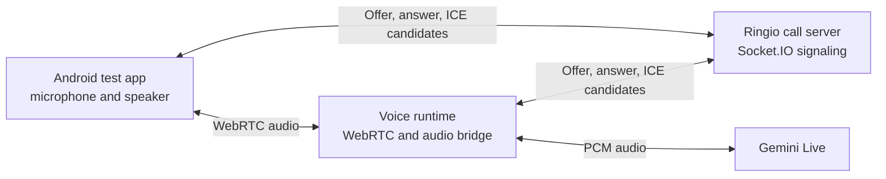

# Annex: Simulated Voice, WebRTC, ICE, STUN, and TURN

## How the agent talks with the test app

The Ringio test app is the simulated phone endpoint. It is not the customer's handset reached over a carrier. The agent runtime, test app, and Ringio server coordinate a session; the agent's audio is connected to Gemini Live by the runtime.

1. The app and voice runtime register with the Ringio call server over Socket.IO.
2. The agent starts a call to a simulated destination. Ringio chooses an available registered app and sends it an incoming-call event.
3. After the app accepts, the participants exchange WebRTC connection descriptions and ICE candidates through Socket.IO. These are setup messages, not audio.
4. Once WebRTC establishes a media path, the app microphone audio reaches the runtime. The runtime converts/bridges the audio to Gemini Live. Gemini's generated audio travels back through the runtime and WebRTC to the app speaker.
5. The Ringio server coordinates signaling but does not carry the live audio. The mobile app does not connect directly to Gemini.

## What the networking terms mean

| Term | Plain-language explanation | Mission in this system |
| --- | --- | --- |
| WebRTC | Browser/mobile technology for real-time audio and video between endpoints. | Carries the live voice audio between the test app and voice runtime. |
| Signaling | Messages used to arrange a WebRTC connection. | Socket.IO carries call control, offer/answer descriptions, and ICE candidates through Ringio. |
| ICE | Interactive Connectivity Establishment; a process for gathering and testing possible network routes. | Finds a working route for the mobile test app and runtime to exchange WebRTC media. |
| STUN | A service that tells an endpoint which public-facing address and port it appears to use. It does not relay the call audio. | Helps ICE test a direct connection through common home/mobile NAT setups. |
| TURN | A relay service that forwards media when a direct WebRTC route cannot be established. | Provides a fallback path for restrictive NATs/firewalls or networks that block direct media. |
| Candidate pair | One local and one remote network route tested by ICE. | The selected pair carries audio once connectivity checks succeed. |

## Current ICE configuration

Ringio's `iceConfig.js` has a default public STUN URL (`stun:stun.l.google.com:19302`). `STUN_URLS` can override it. `TURN_URLS` defaults to empty; when TURN is enabled, `TURN_SHARED_SECRET` is required to create short-lived credentials.

So ICE support exists and a public STUN default is present, but the current setup has no TURN relay configured by default. A deployment-specific STUN/TURN service and credentials should be verified before relying on calls across restrictive or unrelated networks. Same-network testing may work without TURN; connectivity is not guaranteed on every network.

STUN is not a substitute for TURN: STUN helps discover a possible direct route, while TURN relays media when direct routes fail. Without a working TURN service, some calls can fail to establish audio even when call signaling succeeds.

## Configuration references

- [`iceConfig.js`](../../../Ringio/voip-call-server/iceConfig.js) builds the ICE server list and optional temporary TURN credentials.
- [Call-server architecture](../../../Ringio/voip-call-server/ARCHITECTURE.md) describes signaling and the server's no-audio-relay boundary.
- [Mobile-app architecture](../../../Ringio/voip-mobile-app/ARCHITECTURE.md) describes microphone access, WebRTC tracks, and ICE configuration retrieval.
- [Gemini-agent architecture](../../../Ringio/mock-external-service/ARCHITECTURE.md) describes the audio bridge between WebRTC and Gemini Live.