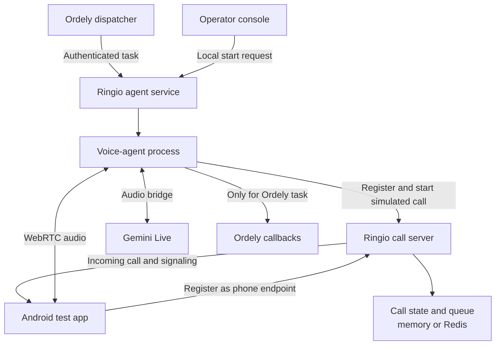

# Annex: How the Telephony Simulation Is Built

## What is being simulated

Ringio demonstrates how a voice agent and a phone-like endpoint coordinate a call. The “destination number” is a routing label for the test system; it is not dialed over a SIM or telephone carrier. The Android app is the simulated phone endpoint. No real customer receives a call.

## The parts

| Part | What it contributes |
| --- | --- |
| **Ordely call orchestration** | Selects eligible pending orders, creates call attempts, observes shop calling hours and retry policy, and dispatches a task when voice dispatch is enabled. |
| **Ringio operator console and control service** | Starts or stops a standalone demo agent process and displays its state and logs. It is a test control panel, not the call-routing server. |
| **Voice-agent process** | Registers as the caller, asks Ringio to start a simulated call, manages the session, and coordinates the Gemini and audio components. |
| **Gemini Live** | Understands the spoken response and generates the agent's speech. It is connected to the voice runtime, not directly to the mobile app. |
| **Ringio call server** | Registers callers and test phones, selects an available phone, manages queue and call state, and relays call-control/signaling messages. It does not generate the voice or carry audio. |
| **Android test app** | Registers as an available phone endpoint, shows incoming simulated calls, and provides the microphone and speaker for the session. Keep it open in the foreground during testing. |
| **Ordely callbacks** | For an Ordely-dispatched task, receive call events and the structured result so Ordely can apply its own order policy. A standalone console demo has no Ordely task ID and does not complete this business workflow. |

## Two ways to start a test

### From Ordely

1. A call attempt is queued for a pending order.
2. When dispatch is enabled, the Ordely backend sends an authenticated task to the Ringio agent service. The task contains a task ID, simulated destination, and the order context needed for the conversation.
3. The agent service starts the voice-agent process with that task. When the call finishes, the task ID lets the agent report its result to Ordely.

This path tests the connection between order orchestration and the simulated voice workflow.

### From the Ringio console

1. An operator chooses a simulated destination and availability policy in the local console.
2. The control service starts a voice-agent process directly.
3. The agent runs through Ringio and the test app, but without an Ordely task ID there is no Ordely order decision to update.

This path is useful for testing Ringio, the app, and the voice conversation independently of Ordely.

## What both paths share

Ringio uses Socket.IO for participant registration, call control, and WebRTC signaling. Once a media connection is established, WebRTC carries the audio between the agent process and the test app; the call server does not relay that media. The agent runtime bridges the audio to and from Gemini Live. See [the audio and networking annex](annex-audio-networking.md) for how that connection is negotiated and the role of ICE, STUN, and TURN.

The call server keeps routing and session state in memory for a local run, or in Redis when configured for shared/persistent state. Agent audio files are written by the agent runtime; the call server stores related transcript and artifact metadata, not the live audio stream.

## Boundaries to remember

- The simulation does not dial the order's customer phone number or use a SIM/PSTN connection.
- The Ringio call server routes and signals; it is not the AI agent and does not carry live audio.
- The mobile app is a test endpoint, not an AI client; it does not connect directly to Gemini.
- Only the Ordely-started path carries an Ordely task ID and can return a result to the order workflow.
- A successful simulated call is not proof of real-world carrier connectivity or production readiness.

## Source references

- [Ordely voice dispatcher](../../backend/src/voice/voice-dispatcher.service.ts)
- [Ringio agent control service](../../../Ringio/mock-external-service/mock-service.js)
- [Ringio agent entry point](../../../Ringio/mock-external-service/agent.js)
- [Ringio agent architecture](../../../Ringio/mock-external-service/ARCHITECTURE.md)
- [Ringio call-server architecture](../../../Ringio/voip-call-server/ARCHITECTURE.md)
- [Ringio mobile-app architecture](../../../Ringio/voip-mobile-app/ARCHITECTURE.md)
- [Order confirmation data flow](data-flow.md)