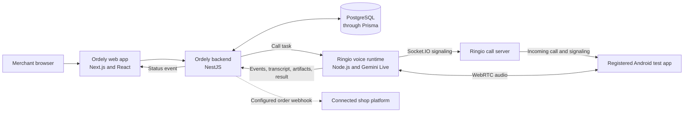

# Voice Confirmation: Technical Architecture

## Scope

This describes the current simulated voice-confirmation path across Ordely and Ringio. Ordely owns order policy and database changes. Ringio routes a simulated call to a registered test app; it is not a carrier and does not dial a customer's real number.

## Components

| Module | Responsibility |
| --- | --- |
| Ordely web app | Lets merchants review orders, call attempts, and outcomes. |
| Ordely backend | Owns call eligibility, task dispatch, callback validation, order policy, and data writes. |
| Call orchestrator | Finds eligible pending orders, respects shop call windows and attempt limits, checks agent capacity, and dispatches one attempt. |
| Voice runtime | Runs the call session, bridges WebRTC audio with Gemini Live, and returns lifecycle events and the agent's structured result. |
| Ringio call server | Registers participants, routes simulated calls to available test apps, and relays Socket.IO call signaling. It does not relay audio. |
| Android test app | Registers as a simulated phone endpoint, answers or declines, and exchanges microphone/speaker audio over WebRTC. |
| Backend callback and policy | Associates results with the dispatched call, checks the result and current order state, and applies allowed changes. |
| Integration webhook | Publishes an order status event to a configured connected platform. This is not a message to the buyer. |

## Technologies and their jobs

| Technology | Used for |
| --- | --- |
| Next.js and React | The merchant-facing web application. |
| NestJS and Node.js | Ordely's API, background orchestration, and the Ringio server/runtime services. |
| TypeScript and JavaScript | Implementing the Ordely backend/frontend and Ringio services. |
| Prisma | Mapping backend data operations to the database schema. |
| PostgreSQL | Persisting shops, orders, call attempts, and related records. |
| Docker Compose | Starting the local Ordely services and database together. |
| Socket.IO | Participant registration, call control, and WebRTC signaling messages. |
| WebRTC | Establishing the live audio connection between the voice runtime and test app. |
| Expo / React Native WebRTC | Running the Android test app and its native microphone, speaker, and WebRTC features. |
| Google Gemini Live (`@google/genai`) | Realtime speech understanding and generated agent audio. |
| PCM audio processing | Adapting audio between the WebRTC stream and Gemini Live's audio format. |

## Decision and update boundaries

The voice agent reports intent, confidence, language, and call details. The backend applies the configured confidence threshold (default `0.7`), checks that the order is still pending, and controls retries. Only a valid result may change the order. An agent's statement is not itself a database write.

Call state (for example, ringing, connected, or ended) is separate from business outcome (confirmed, declined, unclear, or unreachable). Status changes can appear in the merchant app and can be sent to an enabled integration webhook. The inspected flow does not send customers a post-call SMS, WhatsApp, or email.

## Source references

- [Call orchestrator](../../backend/src/calls/orchestration/call-orchestrator.service.ts)
- [Voice dispatcher](../../backend/src/voice/voice-dispatcher.service.ts)
- [Voice result callbacks](../../backend/src/voice/voice-callbacks.service.ts)
- [Order status webhook](../../backend/src/integrations/integration-webhook.service.ts)
- [Ringio call-server architecture](../../../Ringio/voip-call-server/ARCHITECTURE.md)
- [Ringio Gemini-agent architecture](../../../Ringio/mock-external-service/ARCHITECTURE.md)
- [Ringio mobile-app architecture](../../../Ringio/voip-mobile-app/ARCHITECTURE.md)