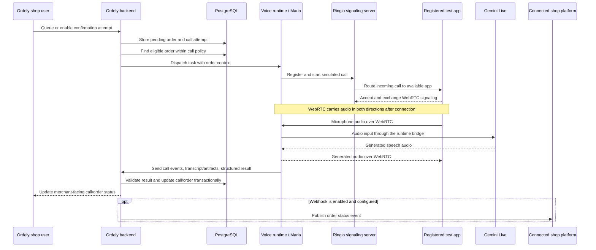

# Voice Confirmation: Data Flow

## End-to-end flow

## What happens at each handoff

1. **An order is pending.** It is entered in Ordely or imported, then stored with its shop and customer/order details.
2. **Ordely selects an attempt.** The call orchestrator checks the order state, shop call window, retry eligibility, and whether the voice agent has capacity. It creates or selects the call-attempt record and dispatches the task.
3. **The voice runtime starts a simulated call.** It registers with Ringio and requests a simulated destination. Ringio routes the attempt to an available registered app; the destination is not dialed through a carrier.
4. **The app and agent negotiate media.** They exchange WebRTC offer/answer descriptions and ICE candidates through Socket.IO. After a connection is selected, audio travels over WebRTC directly between the app and agent runtime, not through the signaling server.
5. **The agent speaks and listens.** The runtime bridges the app's audio to Gemini Live and sends generated speech back to the app. It captures call lifecycle events and conversation data.
6. **The runtime reports back to Ordely.** Authenticated callbacks associate events and the final structured result with the dispatched task. Transcripts and audio artifacts are handled separately from the live audio stream.
7. **Ordely decides what the result means.** Backend policy checks the reported intent and confidence and confirms the order is still pending before applying a change. A completed call is not automatically a confirmed order.
8. **The merchant sees the outcome.** Ordely updates call/order views and may publish a configured order-status webhook to the connected platform.

## Outcome handling

- A clear, sufficiently confident confirmation or decline can update a still-pending order.
- Ambiguous or low-confidence intent is not treated as confirmation; it can be retried or reviewed by staff.
- No answer and technical failures are recorded as call outcomes and follow the bounded retry policy. After the final eligible attempt, unresolved orders can be marked unreachable for staff follow-up.
- If a merchant or another process already changed the order, the callback must not overwrite that decision.

The confidence threshold defaults to `0.7`; the current maximum is three attempts. Configuration and policy are enforced by Ordely's backend, not by the agent's spoken response.

## Notification boundary

There are three different things that can be called a notification:

- **Merchant dashboard update:** call and order status changes are reflected in Ordely for the shop user.
- **Connected-platform webhook:** an enabled integration can receive an `order.confirmed` or `order.cancelled` event.
- **Direct message to the buyer:** no post-call SMS, WhatsApp, or email was found in the current flow. This would need its own channel, consent rules, templates, and delivery tracking.

## Current versus not included

**Current:** simulated Ringio call to a registered app, Gemini Live conversation, backend callbacks and policy checks, call/order persistence, and configured merchant/platform status updates.

**Not included in this simulation:** customer PSTN/SIM dialing, a configured TURN media relay, and direct buyer notifications after the call.